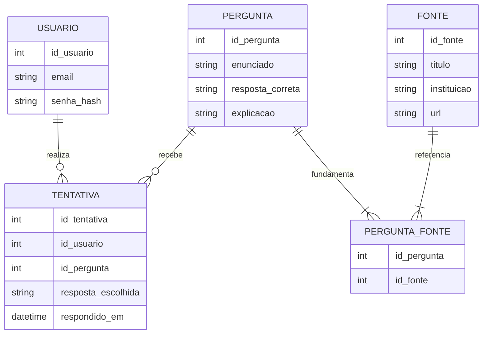

# Modelagem de Dados - REACTIO Sprint 1

## 1. Escopo e decisões

O REACTIO apresenta afirmações educativas sobre energia nuclear. A pessoa usuária escolhe uma resposta entre **Verdadeiro**, **Falso** e **Depende**; em seguida, a aplicação apresenta a explicação e as referências consultadas.

O recorte modela somente cadastro, conteúdo educativo, referências e respostas registradas. Senhas são representadas como hash. Trilhas, progresso gamificado, comentários, perfis detalhados e relatórios ficam fora desta Sprint 1.

## 2. Modelo conceitual



**Entidades e responsabilidade:**

- **USUARIO:** identidade mínima para cadastro e associação das respostas. E-mail é único; a aplicação nunca persiste senha em texto puro.
- **PERGUNTA:** afirmação, resposta esperada e explicação educativa.
- **FONTE:** referência utilizada para fundamentar conteúdo.
- **PERGUNTA_FONTE:** entidade associativa para permitir várias fontes por pergunta e reutilização de uma fonte em várias perguntas.
- **TENTATIVA:** resposta escolhida por usuário para uma pergunta, com data e hora. Mantém histórico de respostas.

## 3. Regras e relacionamentos

1. Um usuário pode registrar zero ou várias tentativas; cada tentativa pertence a exatamente um usuário.
2. Uma pergunta pode receber zero ou várias tentativas; cada tentativa responde a exatamente uma pergunta.
3. Uma pergunta deve ter uma ou mais fontes; uma fonte pode fundamentar uma ou mais perguntas.
4. Uma tentativa aceita somente `V`, `F` ou `D` (Verdadeiro, Falso ou Depende).
5. O resultado de acerto é calculado comparando `TENTATIVA.RESPOSTA_ESCOLHIDA` com `PERGUNTA.RESPOSTA_CORRETA`; ele não é armazenado para evitar redundância.
6. A aplicação deve gerar um hash forte de senha com salt usando biblioteca apropriada. Hashes de exemplo no DML são fictícios.

## 4. Modelo lógico

```text
USUARIO (
  id_usuario PK,
  email UQ,
  senha_hash
)

PERGUNTA (
  id_pergunta PK,
  enunciado,
  resposta_correta,
  explicacao
)

FONTE (
  id_fonte PK,
  titulo,
  instituicao,
  url UQ
)

PERGUNTA_FONTE (
  id_pergunta PK, FK -> PERGUNTA.id_pergunta,
  id_fonte PK, FK -> FONTE.id_fonte
)

TENTATIVA (
  id_tentativa PK,
  id_usuario FK -> USUARIO.id_usuario,
  id_pergunta FK -> PERGUNTA.id_pergunta,
  resposta_escolhida,
  respondido_em
)
```

## 5. Modelo físico Oracle

O script `sql/01_ddl.sql` implementa os tipos Oracle, geração de identificadores, chaves primárias e estrangeiras, unicidade e verificações de domínio. As chaves usam `NUMBER GENERATED BY DEFAULT AS IDENTITY`; textos usam `VARCHAR2` com tamanho limitado; a data da tentativa usa `TIMESTAMP WITH TIME ZONE`.

## 6. Normalização (3FN)

- **1FN:** cada coluna guarda um único valor atômico; listas de fontes não são gravadas dentro de `PERGUNTA`, mas em `PERGUNTA_FONTE`.
- **2FN:** em `PERGUNTA_FONTE`, não há atributos não-chave dependentes de apenas parte da chave composta. Nas demais tabelas, a chave primária é simples.
- **3FN:** atributos descritivos dependem da chave da própria tabela. Dados da fonte ficam em `FONTE`; dados do usuário ficam em `USUARIO`; explicação e gabarito ficam em `PERGUNTA`. O acerto não é duplicado em `TENTATIVA`, pois pode ser derivado da resposta escolhida e do gabarito.

## 7. Referências iniciais para os dados de exemplo

As afirmações de demonstração são educacionais e têm escopo deliberadamente limitado. As referências são páginas institucionais da U.S. Nuclear Regulatory Commission (NRC) e do U.S. Department of Energy (DOE); o produto deve revisar o texto e a adequação das fontes ao público brasileiro antes de publicar conteúdo definitivo.

- NRC, [Frequently Asked Questions About Radiation Protection](https://www.nrc.gov/facilities-safety/radiation-protection/related-information/frequently-asked-questions).
- NRC, [Nuclear Power Plant](https://www.nrc.gov/education-regulatory-research/glossary/nuclear-power-plant).
- NRC, [Backgrounder on Nuclear Reactor Risk](https://www.nrc.gov/regulations-legislation/fact-sheets-brochures/backgrounder-on-nuclear-reactor-risk).
- NRC, [What Is Nuclear Energy?](https://www.nrc.gov/reading-rm/basic-ref/students/what-is-nuclear-energy).
- DOE, [Nuclear](https://www.energy.gov/nuclear).
